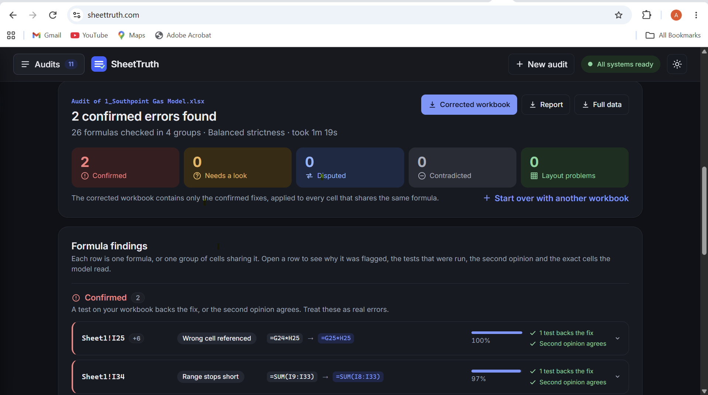

# SheetTruth

SheetTruth finds spreadsheet formulas that compute the wrong thing, and then proves each finding
against the workbook before it reports it.

The errors it looks for are the quiet ones: a total that stops one row short, a sum that reaches
into the price row, a reference that points one row off, a cost added instead of subtracted.
Excel accepts all of them. Every cell still shows a number, so nobody notices until someone
reads the labels. SheetTruth reads the labels with a fine-tuned open-weights model, tests every
finding with code, asks a second model for an independent opinion, and writes the confirmed fixes
into a corrected copy of the workbook.

Live: [sheettruth.com](https://sheettruth.com). Code, data recipe, training, evaluation and the
web application are all in this repository, so every number below can be rerun.

## Why this matters

Spreadsheet errors are common, and a few of them have been very expensive. Field audits of real
business spreadsheets, collected by Raymond Panko, found errors in 24% of 367 spreadsheets in the
older studies and in at least 86% of the spreadsheets audited with better methods from 1997 on;
measured per cell, audited formula error rates of 0.4% to 2.5% are typical
([Panko, "Spreadsheet Errors: What We Know. What We Think We Can Do", EuSpRIG 2000](https://arxiv.org/pdf/0802.3457.pdf)).
At those rates, a model with a few thousand formulas is expected to hold errors.

Some of the best known cases, as reported by
[The Guardian, "Microsoft Excel's bloopers reel: nearly 40 years of spreadsheet errors" (2024)](https://www.theguardian.com/technology/2024/oct/28/microsoft-excels-bloopers-reel-40-years-of-spreadsheet-errors):

- **JPMorgan, the "London Whale" trades (2012).** The bank's risk model ran on spreadsheets that
  were copied and pasted by hand, and one cell divided by the sum of two interest rates instead of
  their average. The model understated the risk, and the trades ended in a loss of about $6bn.
- **Reinhart and Rogoff (2010, found 2013).** A spreadsheet error in a widely cited economics
  paper turned a growth figure for high-debt economies from 2.2% into a decline of 0.1%. The paper
  had been used to support austerity policy after the financial crisis.
- **Fannie Mae (2003).** An accountant entered a wrong formula while adapting to a new accounting
  standard, and the quarterly results carried errors of more than $1bn.
- **Public Health England (2020).** Test results were collected in a file format that could not
  hold all the rows, so records were dropped, and nearly 16,000 COVID-19 cases went unreported
  for days; contact tracers missed thousands of people.

Every one of these is a quiet error: the spreadsheet still showed a number, and the number was
trusted. The JPMorgan case is exactly the kind of formula SheetTruth is built for (a wrong
operation on the right cells); the Reinhart and Rogoff case is a range that did not cover the
rows it should have. Tools that compare a formula with its neighbours catch some of these; a
formula that is wrong on its own, in every cell of its run, needs a reader that understands what
the labels say the cell should compute.

## Built on Meta's Muse models

- **Muse Glimmer 30B** (open weights) is the model that finds the errors. We fine-tuned it with
  QLoRA on a dataset we built from real spreadsheets. It is small enough to fine-tune on one GPU
  and fast enough to score many formula windows in parallel, so a whole workbook is audited in
  about a minute. The adapter is published at
  [Abhisek987/sheettruth-glimmer-30b-lora](https://huggingface.co/Abhisek987/sheettruth-glimmer-30b-lora).
- **Muse Spark 1.3** (Meta model API) is the reviewer. It reads each surviving finding with the
  same context and gives an independent second opinion.
- **Muse Spark Open** was used as the prompted baseline in the evaluation, to measure what the
  fine-tune adds over a general model with the same prompt.

**Runs inside your own network.** Because the finder is an open-weights model with a published
adapter, the verify agent is plain code with LibreOffice, and the reviewer client accepts any
OpenAI-compatible endpoint, the whole audit can be deployed on a company's own servers. A business
that does not want its spreadsheets to leave its network can run the fine-tuned Muse Glimmer 30B
on its own GPU and point the reviewer at a locally hosted model (for example Muse Spark Open), or
skip the reviewer step and rely on the code checks. No workbook needs to reach an outside service.

## How it works

```
workbook ──> structure checks ──> context windows ──> fine-tuned model ──> verify agent ──> second opinion ──> report
             (rules, no model)    (one per run of      (Muse Glimmer 30B,  (recalculation and   (Muse Spark 1.3)
                                   identical formulas)  one window a call)  tie-out checks)
```

1. **Structure checks** (`sheettruth/shape.py`). Rules that need no model: a number typed over a
   formula inside a filled-down run, and a formula whose shape differs from the formulas on both
   sides of it. Each finding comes with the formula the run implies.
2. **Context windows** (`sheettruth/windows/`). Cells that touch each other and share one R1C1
   formula form a run, and one text window is built per run. The window holds the target formula,
   its row and column labels, the 5x5 grid around it, the cells above and below, the neighbours'
   formulas, the referenced ranges with their boundaries, and the labelled constants on the sheet.
   The same builder serves training and inference, so the model always sees the format it was
   trained on. Design notes: `docs/window_design.md`.
3. **Fine-tuned model**. The Muse Glimmer 30B adapter reads one window and answers with a JSON
   verdict: `ok`, `error` (type, corrected formula, one-line reason) or `unsupported`. The
   probability of `error` is read from the generation step, so the flagging cutoff is a parameter.
   Nine error types: `wrong_function`, `skipped_rows`, `extra_rows`, `double_count`, `wrong_sign`,
   `wrong_reference`, `missing_term`, `wrong_operator`, `missing_factor`. Formulas built on functions
   outside SUM, AVERAGE, COUNT, MIN, MAX and plain arithmetic are reported as `unsupported`.
4. **Verify agent** (`sheettruth/verify.py`, orchestrated by the LangGraph workflow in
   `sheettruth/agent/graph.py`). A model verdict is only a claim, so every flagged cell is tested
   without trusting the model's reason: the proposed fix is written into a copy and recalculated
   with LibreOffice; the fix is compared with the formula pattern of neighbouring cells and of the
   same cell on sibling sheets; the cells a range fix adds or drops are inspected; double counting
   is checked in code; a sign finding on a lone negated reference is treated as a convention.
   Outcome per finding: `passed` (the checks support the fix and none contradicts it), `failed`
   (the fix recalculates to an error, or the checks only contradict it) or `no_independent_check`
   (nothing could be tested, or the checks disagree). Details: `docs/verify_agent.md`.
5. **Second opinion** (`sheettruth/agent/reviewer.py`). Findings not contradicted by code are sent
   to the reviewer model with the same window and the claim. It answers `real_error`, `not_error`
   or `cannot_tell` with one sentence. Each finding then carries a final status: `confirmed`,
   `unverified` (shown as "needs a look"), `disputed` or `contradicted`. Workbook evidence outranks
   the reviewer: a finding that a code check supports stays confirmed even if the reviewer
   disagrees. The reviewer runs when its endpoint is configured through the environment; the
   client accepts any OpenAI-compatible endpoint.
6. **Report**. Markdown for people, JSON for software, and a corrected copy of the workbook with
   the confirmed fixes written into every cell of each affected run.

## The application



`webapp/` holds the application: `backend/` (FastAPI) and `frontend/` (React + TypeScript). Upload
a workbook, or try the bundled sample, pick a strictness (the P(error) cutoff: Sensitive 0.3,
Balanced 0.5, Strict 0.7), and follow the audit step by step while it runs in a background worker.
The result page groups findings by status. Each finding opens to show the model's reason, every
code check with its evidence, the reviewer's verdict, and the exact context window the model saw.
Downloads: the corrected workbook, the Markdown report and the full JSON detail. Earlier audits
stay in the side bar. The site is served over HTTPS through Caddy (`webapp/deploy/Caddyfile`).
Every push to `main` runs the tests, builds the front end and deploys to the server
(`.github/workflows/deploy.yml`); details in `docs/deploy.md`.

## Training data

The training set is built by code from real workbooks. The deployed model (v2) was trained on
the public Enron spreadsheet corpus: 15,871 files indexed, 14,901 kept after removing anything
that overlaps the test set by hash, name or label content.

- **Errors**: a real formula broken by one of nine deterministic mutators, each modelled on an
  error shape seen in audited workbooks. Half the time the broken formula is written into the
  whole run of identical formulas, so the model cannot rely on "the odd one out". The copy is
  recalculated with LibreOffice so the cached values match the broken formula, and the window is
  built from that copy only.
- **Hard negatives**: untouched cells where a mutator could have fired, labelled `ok`. They make
  up half of the `ok` examples, so labels alone cannot separate the classes.
- **Reviewer-model proposals**: a reviewer model proposes a realistic mistake for a correct cell.
  Code applies it, recalculates, rebuilds the window and keeps the example only if the evidence
  cells the reviewer named are still in the window.
- A sample of labels was audited by an independent model (`scripts/audit_labels.py`).

Final set: 16,107 training and 1,830 validation examples, split by workbook. Training: QLoRA,
LoRA rank 16, one epoch, loss on the reply only. The first fine-tune (v1) used 4,284 examples and
found 6 of the 29 test errors; v2 found 18. More and better data was the lever that worked.

## Evaluation

Held-out test: the Enron Errors Corpus (Schmitz and Jannach, 2016), 30 real workbooks with 33
formula errors that Enron staff found and fixed themselves. None of these files is in the
training set. The audit scans every in-scope formula cell of the 30 files (16,286 cells in 2,817
windows). An error counts as found when a window covering one of its cells is flagged. Flagged
windows outside the documented set are reported as false alarms, although the corpus lists only
the errors people noticed, not every error in the files.

| system | documented errors found (of 29 covered) | flagged windows outside the documented set | precision |
|---|---|---|---|
| first fine-tune (v1), greedy verdict | 6 | 71 | n/a |
| second fine-tune (v2), P(error) >= 0.5 | 18 | 222 | 0.11 |
| v2 + verify agent (contradicted findings dropped) | 18 | 76 | 0.23 |
| v2 + verify agent + reviewer second opinion | 17 | 31 | 0.38 |

Precision counts windows: windows covering a documented error over all flagged windows. Ten of
the 18 finds come with the exact documented correction. Lowering the cutoff to 0.3 finds 21
before verification at 395 flagged windows. Full reports: `reports/enron_eval_v2.md`,
`reports/enron_eval_v3_verified.md`, `reports/enron_eval_v3_reviewed.md`.

**Prompted baseline.** The same windows and the same prompt were sent to Muse Spark Open, a much
larger general model, on a 578-window subset holding all error windows and 500 random ones. It
found 18 with 49 flagged outside the list (precision 0.29). The fine-tuned 30B model found 18 with
45 outside the list on the same subset. The two models agree on only 16 finds and 25 false alarms.
So the fine-tune matches a much larger general model, and the two models see different things,
which is why the second opinion step exists.

**What the flagged cells outside the list are.** The corpus records the errors people noticed,
not every error in the files. An independent reviewer model was given 160 flagged cells with their
context windows, plus 10 documented errors mixed in unmarked. It recognised 9 of the 10 documented
errors, and judged 59 of the 160 to be real errors (6 distinct issues; 45 of the 59 are one
omission repeated on 45 template sheets of one workbook), 67 not errors, and 33 not decidable
from the window. Of the 31 windows the full pipeline still flags outside the list, 8 are among the
cells that this review called real inconsistencies. The review pack and answers are in `reports/`.

Three of the 33 errors are not covered: one uses a custom add-in function, one uses ROUND, one is
a value cell. Per-error tables, categories and the full false-alarm lists are in `reports/`.

### Second benchmark: ExceLint corpus

To check that the Enron numbers are not specific to one corpus, the same pipeline was run on the
benchmark of the ExceLint study (Barowy, Berger and Zorn, OOPSLA 2018): 70 spreadsheets from the
EUSES corpus, audited by hand by the authors, with 700 annotated cells. 587 of them hold formulas.
Grouped into runs, they give 317 documented formula errors in 36 workbooks, 314 of them in scope.
The audit does not record the correct formula, so the "exact fix" count is not available here.
The set is prepared by `scripts/prepare_excelint.sh`. The leakage filter found no training
workbook that matches any of the 70 files. The P(error) cutoff was fixed at 0.5 on the Enron set
before this benchmark was run; nothing was tuned on it.

6,210 windows covering 19,180 formula cells.

| system | documented errors found (of 314 covered) | flagged windows outside the documented set | precision |
|---|---|---|---|
| v2, P(error) >= 0.5 | 100 | 185 | 0.35 |
| v2 + verify agent (contradicted findings dropped) | 70 | 100 | 0.41 |
| v2 + verify agent + reviewer second opinion | 52 | 49 | 0.52 |

The two checking stages remove 136 of the 185 flagged windows outside the list and keep 52 of
the 100 finds, the same trade as on the Enron set. Recall is much lower than on Enron, and part of
the reason is what the two sets count as an error. The ExceLint annotations mark cells whose
formula breaks the pattern of their neighbours, including cells whose value is unchanged: an
AVERAGE that stops before a blank cell, a relative reference where the peers use an absolute one
to the same cell, a total that sums line items where the peers add subtotals to the same amount.
SheetTruth targets formulas whose result is wrong. We read eleven of the missed errors together
with their windows: five are of that harmless kind, three are real range errors the model missed
with the evidence in view, two cannot be decided from the window, and one is a run whose first
cell is fine and whose second cell is wrong, which the window builder does not see because it
builds the window from the first cell of a run. Lowering the cutoff to 0.3 finds 120 before
verification at 343 flagged windows outside the list. Full reports:
`reports/excelint_eval_v2_model.md`, `reports/excelint_eval_v2_verified.md`,
`reports/excelint_eval_v2_full.md`.

### A third fine-tune that was not shipped

A third adapter (v3) was trained on 30,736 examples, twice the v2 set, built the same way from the
Enron corpus plus the Sheetpedia corpus (web and forum spreadsheets). On the Enron set it looked
like a clear win: 24 of 29 found at P(error) >= 0.5, and 22 found with 137 flagged windows outside
the list at a 0.99 cutoff, against 18 and 222 for v2. On the ExceLint set it was behind v2 at every
cutoff: 77 found with 235 outside the list at 0.5 (v2: 100 and 185), and 20 found at the 0.99
cutoff that worked on Enron. The gain was specific to Enron-style workbooks and did not transfer
to an independent benchmark, so v2 stays deployed. Reports: `reports/enron_eval_v3_model*.md`,
`reports/excelint_eval_v3_model.md`.

## Future scope

The model is the core of SheetTruth, and the planned work is mostly about what the model gets
to see and how much it has learned from.

1. **Workbook and business context.** Today the model judges each formula from its window alone.
   We plan to give it a short description of the workbook and of the business it belongs to (what
   the sheet is for, what the key figures mean), so that a formula is judged against its purpose,
   not only against its neighbours.
2. **Cross-sheet references.** A formula that reads from another sheet is shown with the reference
   only. We plan to pull the referenced cells from the other sheet into the window, with their
   labels, so that errors in cross-sheet formulas can be found and verified the same way.
3. **More formula types.** The model today covers SUM, AVERAGE, COUNT, MIN, MAX and plain
   arithmetic. The next step is lookup and conditional formulas (IF, SUMIF, VLOOKUP and their
   relatives), which need a window that shows the lookup table and new mutators that break them
   in realistic ways.
4. **A chat about the audit.** After an audit, the user should be able to ask questions about the
   findings ("why is I25 wrong", "what changes if I accept this fix") and get answers grounded in
   the same evidence the verify agent collected.
5. **More and better training data.** The results above show that data was the lever from v1 to
   v2, and that the v3 data did not transfer across corpora. The next dataset will mix corpora
   from the start, include more "odd one out" errors, and build each window from the cell of a
   run that differs most from its neighbours.

## Running it

```
pip install -r requirements.txt
python -m pytest -q tests

# model server (Modal account required; the adapter path is a parameter)
python -m modal deploy training/predict_glimmer_modal.py

# reviewer (any OpenAI-compatible chat endpoint; the deployed app uses Muse Spark 1.3)
export SHEETTRUTH_REVIEWER_BASE_URL=https://...  SHEETTRUTH_REVIEWER_MODEL=...  SHEETTRUTH_REVIEWER_API_KEY=...

# one workbook
python scripts/audit_workbook.py path/to/book.xlsx --out reports/audit_book.md

# web application (build the front end first: cd webapp/frontend && npm ci && npm run build)
uvicorn webapp.backend.server:app --host 0.0.0.0 --port 8000
```

LibreOffice is needed on the machine that runs the verify agent (recalculation). Without it the
other checks still run and recalculation is reported as skipped. Without a reviewer endpoint the
second opinion step is skipped and findings are reported from the code checks alone.

## Repository layout

```
sheettruth/windows/     cellinfo.py (workbook model, refs, R1C1, header paths), builder.py (the window), runs.py (runs)
sheettruth/mutators/    one file per error type; base.py is the contract and registry
sheettruth/verify.py    the verify agent's checks
sheettruth/shape.py     structure checks without a model
sheettruth/agent/       LangGraph audit workflow, model clients, report rendering
sheettruth/prompt.py    the prompt and reply parser shared by training and inference
sheettruth/data/        recalc.py (LibreOffice recalculation)
training/               LoRA fine-tune (QLoRA, one GPU) and batched inference, both on Modal
scripts/                corpus conversion and indexing, leakage filter, dataset build, label audit,
                        reviewer-model proposals (one by one and as a Message Batch), test windows,
                        the ExceLint benchmark, evaluation, hosted baselines, the audit CLI
webapp/                 backend/ (FastAPI service, job worker), frontend/ (React + TypeScript), deploy/ (server scripts, Caddyfile)
.github/workflows/      test, build and deploy pipeline
tests/                  mutators, prompt, verify agent, structure checks, the audit graph, the web API, the build scripts
configs/                default.yaml (every knob in one place), v3.yaml (the third-round build)
docs/                   window design, verify agent, deployment, model card, app screenshot
reports/                evaluation reports
```

## Data pipeline

```
python scripts/convert_corpus.py data/raw/enron data/xlsx/enron --workers 4
python scripts/index_corpus.py   data/xlsx/enron data/index/enron --workers 4
python scripts/filter_leakage.py data/index/enron/workbooks.jsonl data/test/enron_errors_xlsx data/index/enron/allowed.json
bash scripts/build_v2.sh
python -m modal run training/train_glimmer_modal.py --run-name <run> --train-file /data/train.jsonl --val-file /data/val.jsonl --epochs 1
python scripts/build_test_windows.py --out data/test/windows.jsonl
python -m modal run training/predict_glimmer_modal.py --input data/test/windows.jsonl --out data/test/predictions.jsonl --adapter-dir /models/<run>/adapter
python scripts/evaluate_enron.py --predictions data/test/predictions.jsonl --windows data/test/windows.jsonl --verify --verify-cache data/test/verify_cache.jsonl
python scripts/evaluate_enron.py --predictions data/test/predictions.jsonl --windows data/test/windows.jsonl --verify --verify-cache data/test/verify_cache.jsonl --review --review-cache data/test/review_cache.jsonl
python scripts/baseline_api.py --input data/test/windows.jsonl --out data/test/predictions_baseline.jsonl --base-url <endpoint> --model <model> --ids data/test/subset_ids.txt
bash scripts/prepare_excelint.sh
```

## Requirements

Python 3.11+, LibreOffice for conversion, recalculation and the verify agent.
